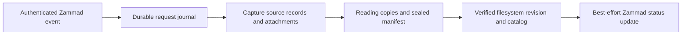

# Chronikwerk — Zammad Ticket Archiver

Auditable Zammad ticket archives in PDF and JSON.

<p>
  
</p>

[](LICENSE)
[](https://www.python.org/downloads/)
[](RELEASE_STATUS.md)
[](https://github.com/sebastianspicker/zammad-ticket-archiver/actions/workflows/ci.yml)
[](https://github.com/sebastianspicker/zammad-ticket-archiver/actions/workflows/pages-demo.yml)

Chronikwerk records authenticated Zammad ticket events in a durable request journal, captures
the source records and attachments, and builds sealed, timestamped preservation packages.
Reading copies include a PDF/A archive copy and a PDF/UA access copy; PDF signing is optional.

<details>
<summary>Status and limitations</summary>

**Project status:** Chronikwerk is an independent experimental project for capturing and
preserving Zammad ticket records. Developed independently alongside my main professional
work. The work-in-progress alpha candidate is a starting point for evaluation and
adaptation, not a ready-to-use archival product. Live Zammad behavior and preservation
requirements still need qualification; begin with disposable test records.

**Disclaimer.** Exported records, signatures and timestamps are not legal evidentiary
certification or retention advice. Operators must determine applicable retention and access
requirements, maintain backups and independently verify preservation outcomes before relying
on the archive.

Version `0.3.0a1` remains an unfrozen, unpublished alpha candidate. Evaluate with
non-production data and read [release status](RELEASE_STATUS.md) before deployment.

</details>

It runs as one service beside Zammad. A bounded background worker captures the ticket, assembles
and verifies a revision in the filesystem store, records it in the catalog, and reports the
outcome back to Zammad. Interrupted requests are recovered from the journal after restart.

Chronikwerk is an independent open-source project. It is not affiliated with, or endorsed by,
Zammad GmbH.

## Screenshot tour

The administration application is optional and disabled by default. Every image below is a real
render of the running service with synthetic local data, and you can click through the same
interface in the [static demo](https://sebastianspicker.github.io/zammad-ticket-archiver/) on GitHub Pages.

| Overview | Jobs |
| --- | --- |
| [](docs/screenshots/admin-overview.png) | [](docs/screenshots/admin-jobs.png) |
| **Ticket history** | **Configuration revisions** |
| [](docs/screenshots/admin-ticket.png) | [](docs/screenshots/admin-revisions.png) |


The interface ships in German and English. These are deterministic documentation renders, not
browser, accessibility, storage, signing, or release evidence. See
[docs/screenshots](docs/screenshots/README.md) for what they do and don't prove.

## What it does

- Commits authenticated single-ticket and all-or-nothing batch requests to a durable journal.
- Captures ticket records, original email where available, and attachment bytes with coverage
  checks before and after capture.
- Renders sanitized, localized PDF/A and PDF/UA reading copies, with optional PAdES signing.
- Builds a manifest with hashes, seals it with a detached CMS signature, timestamps the seal,
  and verifies the package before completing its revision in the filesystem store and catalog.
- Projects the outcome back to Zammad; a failed final status update can be retried without
  discarding a completed revision.
- Offers journal history, process metrics and an optional administration application.



## What `202 Accepted` means

`POST /ingest` returns `202` only after the request is recorded in the journal. It means durable
admission, not completed preservation. A restart recovers interrupted work; operators still need
backups and working local journal storage. Check the stored revision, journal history, manifest
and final Zammad note to establish completion.

The pipeline adds `pdf:processing` before clearing stale error/trigger state. A completed
revision is projected as `pdf:signed`; failures are reported as `pdf:error` according to the
retry policy. `pdf:signed` is a workflow outcome, not proof that optional PDF signing ran.
Inspect the manifest, seal, timestamp and reading copies themselves. See the
[API contract](docs/api.md) and [operations guide](docs/08-operations.md).

## Current limits

The alpha supports one process and one instance per journal. The journal and catalog are
persistent; admin sessions and process metrics have narrower, process-local lifetimes.

- Only the filesystem archive store is implemented. S3 Object Lock, hold/disposal commands,
  scheduled fixity/reconciliation, evidence renewal and validation-material collection remain
  unimplemented as listed in the [operations guide](docs/08-operations.md#not-built-yet).
- Original-message and attachment capture depend on configured limits and the upstream data;
  inspect the manifest's coverage rather than assuming completeness. Live Zammad endpoints,
  network-filesystem behavior and target trust infrastructure still require qualification.
- Archive ACLs, backups, externally enforced retention and encryption remain operator duties.
- There is no admin RBAC, SSO, secret editor, live reload or UI-controlled restart.
- Tagged PDFs and browser tests alone do not establish PDF/UA or WCAG conformance.

See [architecture](docs/01-architecture.md), [security](docs/09-security.md), and the
[alpha evaluation guide](docs/alpha-release.md) for the remaining acceptance boundaries.

## Requirements

**Production:** Linux, Docker Engine, Docker Compose 2.24+, a reachable Zammad instance, and
archive storage writable by container UID/GID `10001`.

**Local development:** Python 3.14+, Node.js 24–26, and the system libraries WeasyPrint needs.
Docker is required for container validation. PDF/UA validation uses veraPDF 1.30.1.

## Quick start

### Docker Compose

```bash
cp .env.example .env
```

Replace every placeholder. These values cover the Zammad connection and archive root:

```bash
ZAMMAD__BASE_URL=https://zammad.example.com
ZAMMAD__API_TOKEN=replace-with-zammad-api-token
ZAMMAD__WEBHOOK_HMAC_SECRET=replace-with-at-least-32-random-characters
STORAGE__ROOT=/mnt/archive
```

Before starting, complete the [deployment prerequisites](docs/deploy.md): mount the seal PFX,
trust anchors and retention policy, configure the timestamp authority, and provide persistent
local journal/catalog storage. The four values above alone are insufficient for runtime startup.
After that preparation, start the service:

```bash
docker compose up -d --build
docker compose ps
curl --fail --silent --show-error http://127.0.0.1:8080/healthz
```

The default Compose mapping publishes only on `127.0.0.1:8080`. The deep health check at
`/healthz?deep=true` creates and removes a file under `storage.root`; expose it only on a trusted
operator network.

### Development checkout

```bash
python3.14 -m venv .venv
. .venv/bin/activate
python -m pip install --only-binary=:all: --require-hashes -r requirements/tools.lock
python -m pip install --only-binary=:all: --require-hashes -r requirements/dev.lock
python -m pip install --no-deps --no-build-isolation -e .
npm ci --ignore-scripts
chronikwerk
```

The project does not publish an installation artifact yet. Install from a reviewed source
checkout or build a wheel with `make build`.

## Configuration

Configuration precedence, highest to lowest: process environment, managed non-secret overlay,
YAML, `.env`, file secrets, then model defaults. Nested environment keys use `__`. Validate the
effective configuration before startup:

```bash
chronikwerk-admin validate-config
chronikwerk-admin dump-config   # secrets are redacted
```

Use [config/config.example.yaml](config/config.example.yaml) as a YAML starting point. The full
schema, aliases, defaults, validation rules, and reviewed transport overrides live in the
[configuration reference](docs/config-reference.md).

## Zammad setup

The default trigger tag is `pdf:sign`. Chronikwerk reads the custom fields `archive_path`,
`archive_user_mode`, and `archive_user`. Follow the [Zammad setup guide](docs/02-zammad-setup.md)
to create the fields, configure the webhook HMAC, add workflow rules, and run a smoke test.

## Interfaces

| Interface | Authentication | Purpose |
| --- | --- | --- |
| `POST /ingest` | HMAC | Admit one Zammad webhook payload. |
| `POST /ingest/batch` | HMAC | Atomically admit up to 100 payloads. |
| `POST /retry/{ticket_id}` | Bearer token | Force one reprocessing attempt. |
| `GET /jobs/history` | Bearer token | Read durable journal request history. |
| `GET /healthz` | None | Shallow or deep storage check. |
| `GET /metrics` | Bearer token | Read optional Prometheus metrics. |
| `/admin/*` | Session and CSRF | Use the optional administration application. |
| `/docs`, `/redoc`, `/openapi.json` | None | FastAPI-generated API schema. |

Optional routes are registered only when enabled. Full request, response, HMAC, and admin
contracts are in the [API reference](docs/api.md).

Installed commands: `chronikwerk`, `chronikwerk-admin validate-config`,
`chronikwerk-admin dump-config`, `chronikwerk-admin list-config-revisions`, and
`chronikwerk-admin stage-config-rollback`, and offline `chronikwerk-admin verify --path`.
External ASGI servers can import
`chronikwerk.asgi:app`.

## Repository map

| Path | Purpose |
| --- | --- |
| `src/chronikwerk/` | Python service, templates, and packaged admin assets. |
| `frontend/` | TypeScript and modular CSS sources for the admin application. |
| `config/` | Complete example YAML configuration. |
| `tests/` | Unit, HTTP/Zammad contract, integration, static, and browser checks. |
| `scripts/ci/` | Deterministic validation, packaging, and image-smoke scripts. |
| `infra/systemd/` | Optional systemd wrapper around Docker Compose. |
| `demo/site/` | Mock-only source for the static administration demo. |
| `docs/` | Architecture, integration, operator, security, and release references. |

The browser-served files under `src/chronikwerk/web/static/admin/` are generated from `frontend/`
and intentionally committed as package data. `build/`, `dist/`, caches, virtual environments,
local configuration, credentials, admin state, and archive output are not source.

## Development and verification

Use the Makefile from the repository root:

| Command | Purpose |
| --- | --- |
| `make PYTHON=.venv/bin/python lint` | Run Ruff lint. |
| `make PYTHON=.venv/bin/python format` | Rewrite Python formatting. |
| `make PYTHON=.venv/bin/python typecheck` | Run mypy over the repository. |
| `make PYTHON=.venv/bin/python test-fast` | Run unit tests. |
| `make PYTHON=.venv/bin/python test` | Run all Python tests with coverage. |
| `make frontend-check` | Type-check and rebuild frontend assets, then compare packaged output. |
| `make docs-check` | Validate required Markdown, local links, and screenshot metadata. |
| `make PYTHON=.venv/bin/python verify-core` | Run the complete non-container gate. |
| `make PYTHON=.venv/bin/python verify` | Add the production-image smoke test. |

`make format`, `make frontend-update`, `make build`, and some check targets write files — review
their diffs. The separate PDF gate is:

```bash
make pdf-ua-check PDF_FILES="unsigned.pdf signed.pdf"
```

Contribution workflow and surface-specific checks are in [CONTRIBUTING.md](CONTRIBUTING.md).
Release-only external and manual gates are in the
[release checklist](docs/release-checklist.md).

## Static administration demo

`make dev` starts the real FastAPI service and needs real local configuration. For a
non-operational, mock-data-only visual reference, build the GitHub Pages artifact:

```bash
make PYTHON=.venv/bin/python pages-demo-check
python -m http.server 8000 --directory build/pages-demo
```

Open `http://localhost:8000/`. The demo uses synthetic tickets, jobs, configuration revisions,
and browser-local state. It makes no backend or external network requests and cannot archive a
ticket, write configuration, or contact Zammad. The Pages workflow deploys only this static
artifact after manual dispatch from `main`; it is not a Chronikwerk deployment.
General CI is automatic only for Dependabot-authored PRs; security checks remain automatic.
Prerelease preparation and Docker checks also require manual dispatch.

## Deployment and operation

The maintained production path is [docker-compose.yml](docker-compose.yml), optionally wrapped by
[infra/systemd/chronikwerk.service](infra/systemd/chronikwerk.service). Put a trusted TLS proxy or
private ingress in front of the loopback bind. Do not expose the admin application, metrics, deep
health, or FastAPI documentation to untrusted networks.

Use the [deployment guide](docs/deploy.md) for host layout, signing mounts, and startup, and the
[operations runbook](docs/08-operations.md) for shutdown, update, rollback, monitoring,
reconciliation, retry, and troubleshooting.

## Documentation

The [documentation index](docs/README.md) links every maintained reference. Popular entry points:

- [Architecture](docs/01-architecture.md)
- [Configuration](docs/config-reference.md)
- [API](docs/api.md)
- [Deployment](docs/deploy.md)
- [Operations](docs/08-operations.md)
- [Security model](docs/09-security.md)
- [Administration frontend](docs/admin-frontend.md)
- [Release status](RELEASE_STATUS.md)
- [Security policy](SECURITY.md)

## License

Chronikwerk is licensed under the [MIT License](LICENSE).
