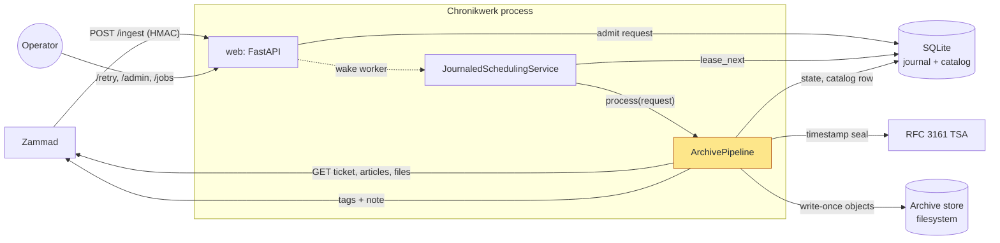
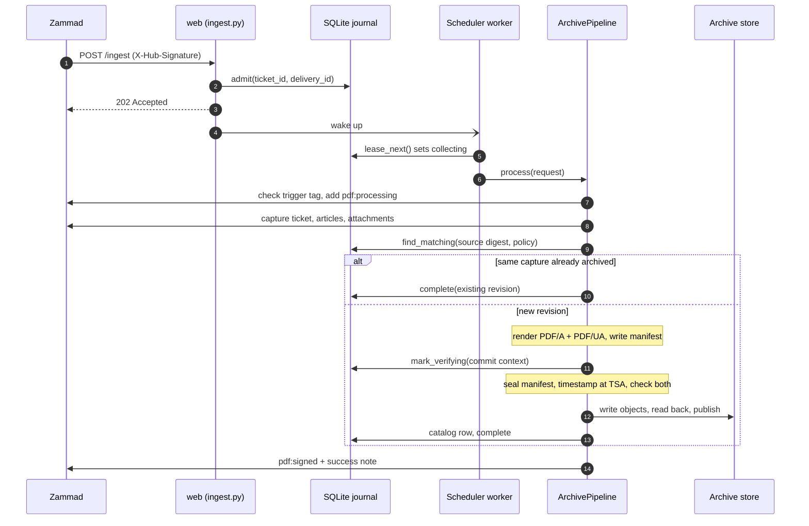
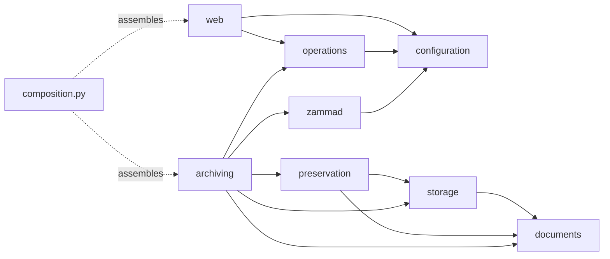
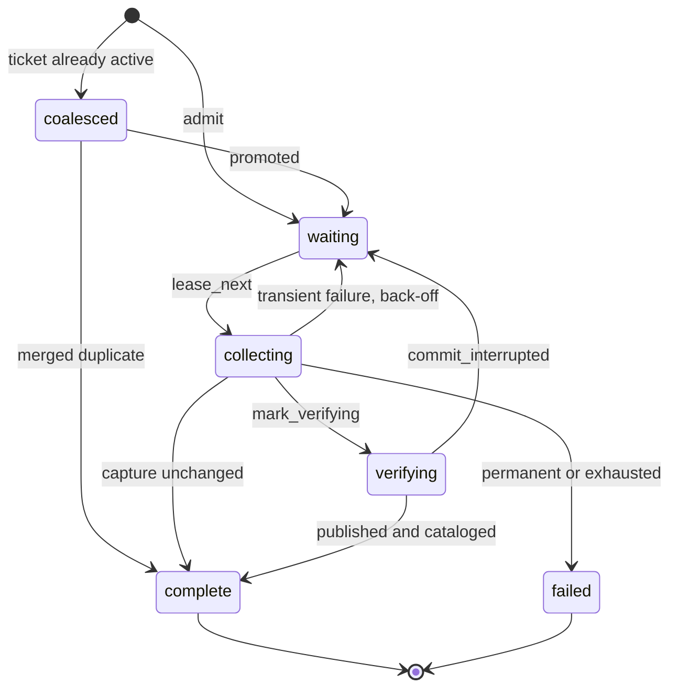

# Architecture

Chronikwerk is a modular monolith. One FastAPI process accepts authenticated Zammad webhooks and
operator retries, records every request in a durable journal, runs bounded background capture work,
writes one sealed, timestamped package per ticket revision into a write-once archive store, and
projects the outcome back to Zammad.

## System overview

What runs where, and what does the process talk to?

Everything inside the box is one Python process started by `chronikwerk` (uvicorn) or imported
as `chronikwerk.asgi:app`. The web layer only writes to the journal and wakes the scheduler; all
Zammad reads, rendering, sealing and storage writes happen in `ArchivePipeline`, called by one
of `admission.max_running` worker tasks. The SQLite file lives on local disk; the archive store is
the configured `storage.root`, typically a host-mounted share. In production a TLS proxy sits in
front of the loopback bind ([deploy.md](deploy.md)); it is not part of this repository.

Where in the code:

- Entry points: [runtime.py](../src/chronikwerk/runtime.py) (`chronikwerk`),
  [asgi.py](../src/chronikwerk/asgi.py), [cli.py](../src/chronikwerk/cli.py) (`chronikwerk-admin`).
- Wiring: [composition.py](../src/chronikwerk/composition.py) and
  [composition_preservation.py](../src/chronikwerk/composition_preservation.py)
  (`build_preservation_services`).
- Web: [web/app.py](../src/chronikwerk/web/app.py) (`create_app`),
  [web/routes/ingest.py](../src/chronikwerk/web/routes/ingest.py),
  [web/middleware/hmac_verify.py](../src/chronikwerk/web/middleware/hmac_verify.py).
- Workers and maintenance: [operations/scheduling.py](../src/chronikwerk/operations/scheduling.py).
- Pipeline: [archiving/pipeline.py](../src/chronikwerk/archiving/pipeline.py).

## What happens when a ticket is tagged for archiving

A Zammad trigger sends a signed webhook when an agent adds the trigger tag. This is the path
from that webhook to a published revision.

Steps 1–3 are the whole HTTP request: the HMAC middleware has already checked the signature, and
`202` means only that step 2 committed. Everything from step 5 on runs in a background worker and
can be interrupted; the commit context written in step 11 is what lets a restart finish a
half-written revision instead of starting over. Step 14 is best effort: if it fails, the revision
stays complete and the maintenance task retries the Zammad update. Operator retries (`POST /retry/{ticket_id}`) enter at
step 2 with source `retry` and skip the trigger-tag check.

Where in the code:

- Steps 1–3: `ingest_webhook` in [web/routes/ingest.py](../src/chronikwerk/web/routes/ingest.py),
  `JournaledSchedulingService.schedule` in
  [operations/scheduling.py](../src/chronikwerk/operations/scheduling.py),
  `RequestJournal.admit` in [operations/journal.py](../src/chronikwerk/operations/journal.py).
- Steps 4–6: `_work` / `_lease` in [operations/scheduling.py](../src/chronikwerk/operations/scheduling.py),
  `RequestJournal.lease_next`.
- Step 7: `ArchivePipeline.process` in [archiving/pipeline.py](../src/chronikwerk/archiving/pipeline.py),
  `apply_processing` in [archiving/tags.py](../src/chronikwerk/archiving/tags.py).
- Step 8: `capture_ticket` in [archiving/capture.py](../src/chronikwerk/archiving/capture.py), using
  [zammad/gateway.py](../src/chronikwerk/zammad/gateway.py).
- Steps 9–10: `ArchiveCatalog.find_matching` in
  [preservation/catalog.py](../src/chronikwerk/preservation/catalog.py), `RequestJournal.complete`.
- Rendering and manifest: `render_reading_copies` in
  [archiving/rendering.py](../src/chronikwerk/archiving/rendering.py), `assemble_package` in
  [archiving/assemble.py](../src/chronikwerk/archiving/assemble.py).
- Steps 11–13: `commit_revision` in [archiving/commit.py](../src/chronikwerk/archiving/commit.py),
  `check_seal_and_token` and `read_back` in
  [archiving/commit_checks.py](../src/chronikwerk/archiving/commit_checks.py), the store in
  [storage/archive_fs.py](../src/chronikwerk/storage/archive_fs.py).
- Step 14: `publish_revision_status` in
  [archiving/pipeline_status.py](../src/chronikwerk/archiving/pipeline_status.py).

## Pipeline steps

The same path in pipeline terms, including the failure handling:

1. Check that the ticket still carries the trigger tag (a forced retry skips this check) and apply
   `pdf:processing`.
2. Capture: collect the ticket, the articles, each email article's original message and every
   attachment's bytes into a local build area, comparing an inventory taken before and after.
3. Compute the source digest and the policy ID. If the catalog already holds a complete revision
   with the same ticket, source digest and policy ID, the request resolves to that revision and
   the pipeline continues at step 8.
4. Render the reading copies (PDF/A-2u and PDF/UA-1) from one snapshot; the PDF/A copy is PAdES
   signed when signing is enabled.
5. Assemble the package: `capture.json` and `manifest.json` with every file's size and SHA-256.
6. Seal the manifest (detached CMS signature) and timestamp the seal (RFC 3161), then check both
   against the trust anchors.
7. Commit to the write-once store: write the objects, read everything back, publish the revision
   with its final retention date, and insert the catalog row.
8. Apply `pdf:signed` and post the internal success note. This step is best effort: a failure
   leaves the revision complete and marks the Zammad update for a later retry.

A failure before step 7 completes posts an error note, applies `pdf:error` and is journaled as
transient (retried with back-off) or permanent. See [08 - Operations](08-operations.md) for the
error codes.

## Modules

| Module | Responsibility |
| --- | --- |
| `composition.py` | Converts validated configuration into narrow runtime options and builds the runtime objects (journal, catalog, archive store, scheduler, Zammad client, pipeline). |
| `archiving/` | The pipeline and its stages: capture, package assembly, sealed commit and resume, Zammad status projection, Zammad-to-snapshot mapping, tag state machine, notes, failure policy, retry, and archive paths. |
| `zammad/` | DTOs, policy-checked bounded transport, and the resource gateway. |
| `documents/` | Snapshot models, HTML sanitization, templates, PDF rendering, PAdES signing, and RFC 3161 timestamping. |
| `storage/` | Path layout, root-confined filesystem operations, and the write-once archive store (protocol and filesystem implementation). |
| `preservation/` | The package format: manifest model and parsing, package builder, revision IDs and key prefixes, content digests, manifest seal and token checks, offline verification, and the catalog. |
| `configuration/` | Settings model, precedence, validation, settings redaction, retention policy file, and managed non-secret revisions. |
| `operations/` | `TicketJob` envelopes, the request journal, journaled scheduling and shutdown, job history, logging, and metrics. |
| `web/` | FastAPI app, public routes, middleware, administration UI/API, templates, and generated static assets. |

## Dependency direction

Arrows point from a module to the modules it may import; they are permissions, not a claim that
every edge is present. `tests/unit/configuration/test_architecture.py` holds the authoritative map
and fails on any other edge or cycle.

- `composition.py` may import any concrete module it needs to assemble the process.
- `web` depends only on `configuration` and `operations`; it does not implement archival work.
- `archiving` is the only coordinator. `zammad`, `documents`, `storage`, and `preservation` never
  import it, and `documents` does not know Zammad wire formats or process mechanics; it depends
  only on shared leaves. `storage` imports document models only for types. `preservation` knows
  the package format, sealing, verification, and the catalog, but not Zammad or the journal.
  `archiving` receives narrow options built by `composition.py` and imports no `configuration`
  module.
- Pure archive policy (`path`, `notes`, `tags`, `error_policy`) imports no feature package.
- Shared leaves at the package root import no other chronikwerk module: `failures.py`
  (error classification), `outbound.py` (HTTP/DNS trust and bounded response helpers),
  `timestamps.py`, `redaction.py` (the single secret scrubber), `concurrency.py`
  (cancellation-safe thread offloading), `i18n.py`, and `_version.py`.
  Add another root module only for a concept with several independent owners.
- Cross-package imports of underscore-prefixed implementation modules are forbidden. The old
  `app`, `adapters`, `domain`, `config`, and `observability` package families are gone.

## State and consistency

Three kinds of state exist, and they have different authority.

- **The package is the record.** A published revision in the archive store, with its manifest,
  seal and timestamp token, is what Chronikwerk preserves. Nothing else is authoritative for what
  was archived.
- **The journal and the catalog are indexes and bookkeeping.** Both live in one SQLite database
  (`journal.path`, WAL, `synchronous=FULL`) on local disk, never on the archive share. The journal
  holds every request and its state; the catalog holds one row per complete revision. The catalog
  can be rebuilt from the manifests in the store (`ArchiveCatalog.rebuild_from_store`; a command
  line entry for it is not built yet). The journal is not rebuilt from the store, so it needs
  backup like any other state file.
- **Managed non-secret configuration revisions** are durable and become active after an external
  restart.

`202` means the request is durably recorded, not archived. Request states are `waiting`,
`collecting`, `verifying`, `complete`, `failed` and `coalesced`. At most one request per ticket is
active (`waiting`, `collecting` or `verifying`), enforced by a partial unique index. A request that
arrives for a ticket with an active request is stored as `coalesced` and is later merged into, or
promoted behind, the active one; a repeated `X-Zammad-Delivery` ID adds no row.

How a request moves through those states:

`coalesced` rows wait for the active row to finish: the oldest is promoted to `waiting`, and plain
duplicates that already existed are completed with the promoted row's revision. A restart sends
`collecting` rows back to `waiting` and resumes `verifying` rows in place (rules below). The
transitions are implemented in [operations/journal.py](../src/chronikwerk/operations/journal.py)
(`admit`, `lease_next`, `mark_verifying`, `complete`, `fail_transient`, `fail_permanent`,
`recover_after_restart`); the state names are in
[operations/journal_types.py](../src/chronikwerk/operations/journal_types.py).

Resume rules after a restart, applied by `JournaledSchedulingService.start` before workers begin:

- `collecting` requests return to `waiting`. The interrupted attempt counts as a failure; a request
  interrupted more often than `capture.retry.max_attempts` allows ends in `failed`
  (`interrupted_repeatedly`). The local build area does not survive, so collection starts again.
- `verifying` requests resume at their recorded commit step. The pipeline reads back what the
  store holds under the revision's prefix. If the manifest, seal and token are all there, it
  checks them again, publishes the revision and completes the request. If the seal files were not
  stored yet, the staged revision is discarded and the request fails transiently with
  `commit_interrupted`; the next attempt captures again under a new revision ID.
- Transient failures return to `waiting` with exponential back-off; permanent failures and
  exhausted retries end in `failed`.

Archive publication and Zammad finalization are not one distributed transaction. If the revision is
complete but `pdf:signed` or the note could not be written, the request stays `complete` with
`zammad_status` `failed`; the revision remains authoritative. The maintenance task
(`JournaledSchedulingService.run_maintenance`, at start and every 15 minutes) repeats pending or
failed Zammad updates and reports final failures (see [08 - Operations](08-operations.md)).

Admission counters, running tasks and admin sessions are process-local. Chronikwerk stays a single
process: SQLite is not shared between instances, and multiple instances can race. Job history reads
the journal, so it survives a restart.

The composition root builds the journal, the catalog, the archive store, one scheduler and one
shared Zammad client, and passes the scheduler and history to
`create_app(settings, *, scheduler=None, history=None, cleanup=None)`; without a scheduler the app is
read-only. Request-serving state (admin sessions, the managed configuration store, rate-limit
buckets) is created per application by `create_app`. The remaining module-level state is deliberate:
process-wide Prometheus metrics, the PDF signer cache, and the WeasyPrint render lock. The pipeline
borrows the shared client and never opens or closes it.

On shutdown the scheduler's `aclose()` stops accepting and leasing work, drains in-flight requests
for `admission.shutdown_timeout_seconds`, and then cancels the remaining ones. A cancelled request
keeps its journal state and is recovered by the next start. The web lifespan finally calls the
injected cleanup callback, which closes the shared Zammad client. See
[ADR 0009](adr/0009-composition-owned-runtime-state.md),
[ADR 0011](adr/0011-durable-request-journal.md),
[ADR 0012](adr/0012-sealed-preservation-package.md) and
[ADR 0013](adr/0013-write-once-archive-store.md).

## External boundaries

- **HTTP:** webhook, batch, retry, health, metrics, history, and administration contracts in
  [api.md](api.md).
- **Zammad:** fixed `/api/v1` resource shapes, token authentication, deny-by-default outbound
  transport policy, and workflow tags/notes.
- **Archive store:** the configured archive root, sanitized key prefixes, descriptor-relative
  symlink-resistant writes, create-only objects, and the package format in
  [03 - Data model](03-data-model.md).
- **Documents:** packaged templates, PDF/A-2u and PDF/UA-1 rendering, and an optional PAdES
  signature on the archival copy. The manifest seal and its RFC 3161 token are described in
  [06 - Signing and timestamping](06-signing-and-timestamp.md).
- **Deployment:** console scripts, Docker/Compose, and systemd interfaces documented in
  [deploy.md](deploy.md).

## Where code belongs

Put product rules, Zammad-to-snapshot mapping, tag transitions, and archive outcomes in `archiving`;
Zammad wire formats and calls in `zammad`; rendering and signing in `documents`; the package format,
sealing, verification and catalog in `preservation`; write-once object storage in `storage`;
settings and managed revisions in `configuration`; the journal and process mechanics in
`operations`; and HTTP/admin delivery in `web`. Shared code belongs in the module that
owns the concept, not in a generic helper package; new volatile state is built in `composition.py`
and passed in, not held in a module global.
