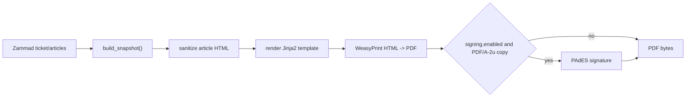

# PDF rendering

The PDF pipeline builds a snapshot, renders bundled HTML templates, and converts
the result to PDF bytes with WeasyPrint.

## Pipeline

WeasyPrint renders once per reading copy variant from the same snapshot; see
[Reading copies](#reading-copies). Only the PDF/A-2u archival copy is signed.

Code paths:

- `src/chronikwerk/archiving/snapshot.py`
- `src/chronikwerk/documents/templates.py`
- `src/chronikwerk/documents/pdf.py`
- `src/chronikwerk/documents/templates/`

## Template contract

Bundled template:

- `src/chronikwerk/documents/templates/default/ticket.html`

Provided variables:

- `snapshot`
- `ticket` (`snapshot.ticket`)
- `articles` (`snapshot.articles`)
- `articles_total`, `articles_included`, and `articles_omitted`
- normalized `pdf_locale` (`de-DE` or `en-GB`) and localized labels

Article fields include:

- `id`
- `created_at`
- `internal`
- `sender`
- `subject`
- `body_html`
- `body_text`
- `attachments[]`

## HTML safety

- Jinja autoescape is enabled.
- Article bodies marked as HTML (or containing common markup) are processed by
  a dependency-free allowlist sanitizer before rendering.
- Rich formatting, tables, and safe links are retained; scripts, styles, forms,
  event-handler/style attributes, and dangerous or scheme-relative URLs are
  removed.
- Malformed markup is recovered into a bounded fragment. If sanitization fails,
  the source is escaped and rendered through the plain-text fallback.
- The reading copies render attachment metadata only. The attachment bytes are
  captured separately and stored in the package, never rendered or opened.

## Limits

Relevant settings:

- `PDF__MAX_ARTICLES`
- `PDF__ARTICLE_LIMIT_MODE`

In the reading copies, attachments are represented as metadata only (`filename`, size,
content type, and IDs). The attachment bytes are limited by `capture.max_attachment_bytes`
and `capture.max_package_bytes`, not by the PDF settings. Article limits still fail the job
or cap and continue according to `PDF__MAX_ARTICLES` and `PDF__ARTICLE_LIMIT_MODE`; they
shape the reading copies only, because `source/articles.json` in the package always holds
the complete response.

The limit is checked against fetched article DTOs before body normalization. In
`fail` mode, an oversized ticket is rejected immediately. In `cap_and_continue`
mode, raw articles are sorted by creation time and ID; missing timestamps sort
last and naive timestamps are interpreted as UTC. Only selected articles are
sanitized and normalized, in a cancellation-safe worker thread. A zero limit
retains every article.

When `cap_and_continue` omits articles, the PDF displays total, included, and omitted
counts prominently. The document never reports a capped export as complete. The package
manifest's `coverage` describes what was captured from Zammad, not what the reading copy shows.

## Accessibility and pagination

Both reading copies use semantic heading levels, a meaningful outline, full language metadata,
page identity, page counters, and DejaVu Sans; the accessible copy uses WeasyPrint's `pdf/ua-1`
output variant.
Articles may split across pages; headings, short attachment rows, metadata blocks, and
table rows avoid orphaning where practical. Long URLs, preformatted text, images, and
wide tables are contained within A4 bounds.

The renderer option is not a conformance claim. Release validation requires veraPDF
1.30.1 with profile `ua1` for signed and unsigned fixtures plus human reading-order,
outline, language, and assistive-technology checks.

Ticket pipelines may run concurrently, but entry into the native WeasyPrint/
FontConfig/Pango renderer is serialized inside worker threads. This keeps native
renderer state off the event loop and prevents concurrent render calls from
crashing the service process.

## Reading copies

`render_pdf` takes a `pdf_variant`: `pdf/ua-1` (the default) or `pdf/a-2u`. WeasyPrint
cannot emit one file that declares both standards, so the archive pipeline renders two
reading copies from one snapshot. `pdf.reading_copies` (default `["pdf/a-2u", "pdf/ua-1"]`)
selects which are produced:

- **Archival copy** (`pdf/a-2u`, tagged), stored as `reading-copy.pdf`: the long-term
  preservation rendition. It declares PDF/A-2u in its XMP metadata (`pdfaid:part="2"`,
  `pdfaid:conformance="U"`) and is the only copy that receives the PAdES signature when
  signing is enabled.
- **Accessible copy** (`pdf/ua-1`), stored as `reading-copy-ua.pdf`: the rendition for
  assistive technology. It declares `pdfuaid:part="1"` and is never signed.

`render_reading_copies` in `archiving/rendering.py` builds the snapshot once, renders
each requested variant from it, and returns a `ReadingCopies` bundle with the signing
certificate fingerprint of the archival copy. Both copies are rendered from the captured
articles, so they show the same state as the package's `source/` files.

The variants are asserted by their XMP identifiers and tag structure only; PDF/A
conformance is not validated here and still requires veraPDF.
